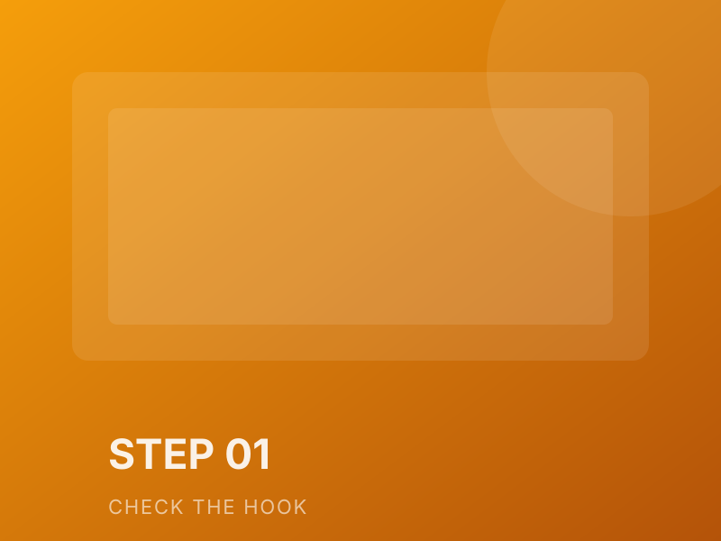

# 多图案例：一篇图文的视觉拆解

同一篇图文，换了三次封面、两组配图。这篇留下的是**视觉决策**，不是最终文件。

## 封面：先让人停下来

初稿放了三个卖点、两个数字、一个人物。缩到手机尺寸，什么都看不清。终稿只留一句话和一个对比色块，反而更容易被点开。

## 内文配图：一张图只讲一件事

配图不是装饰，是论证的一部分。每张图只承担一个信息点：对比、步骤、结果。

## 排版检查

| 项目 | 标准 | 这篇 |
|---|---|---|
| 正文字号 | 手机不小于 16px | 17px |
| 行高 | 1.7–1.8 | 1.75 |
| 图片宽度 | 不超过正文宽 | 100% |
| 图注 | 每张图都有 | 有 |
| 对比度 | 深色模式下不刺眼 | 已检查 |

## 结论

封面做减法，配图做分工，排版做一致性。三件事都不需要设计天赋，只需要每次检查同一张表。
