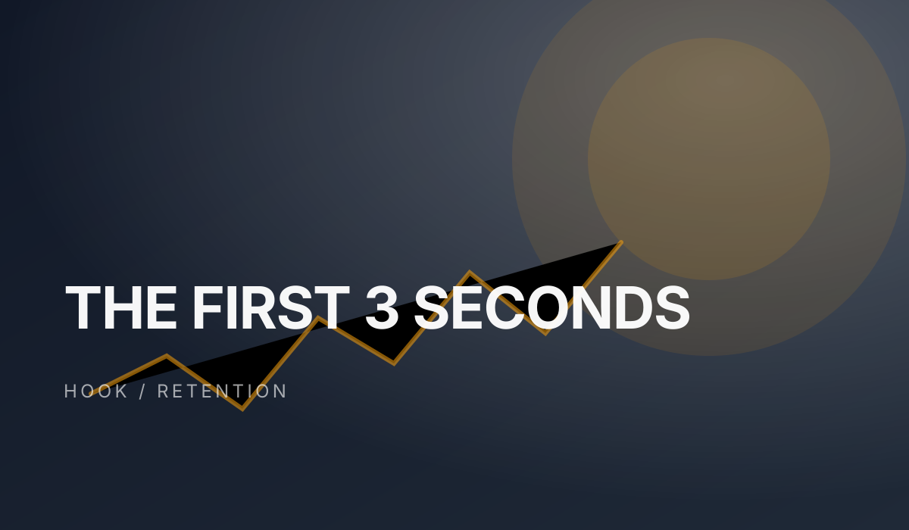

# 一条口播视频的完整生产包

这条片子不是教程，是一个可以直接照着拍的终稿。它回答一个问题：**为什么你的内容没人看？** 我的答案是：不是流量问题，是前 3 秒没有给出承诺。

> 这是终稿，不是教程。结构、口播、封面、字幕都已经定稿。要改，先改 brief，不要直接改稿。

## 一、这条片子为谁做

给做了半年内容、每周更新两三条、但播放量一直卡在 500 的人。他们不缺执行力，缺的是一条能让人停下来的开场。



## 二、七段结构

### 1. 钩子（0–3 秒）

不要自我介绍，不要铺垫。第一句话必须是一个**反常识的判断**，或者一个**具体的损失**。

> 如果你发的每条内容都像在自言自语，问题不在剪辑，在开场。

### 2. 承诺（3–10 秒）

告诉观众：看完能得到什么。一句话，不超过 20 个字。

### 3. 论证（10–90 秒）

只讲一个例子。例子要有数字、有前后对比、有失败的部分。

| 段落 | 目标 | 验收 |
|---|---|---|
| 钩子 | 让人停下来 | 3 秒内说出反常识判断 |
| 承诺 | 让人愿意继续 | 一句话说清收益 |
| 论证 | 让人相信 | 一个带数字的真实案例 |
| 收束 | 让人记住 | 一句可复述的话 |

## 三、终稿检查

- [x] 事实核查：每个数字都有来源
- [x] 平台规则：没有绝对化用语
- [x] 人设一致：没有突然变成专家口吻
- [x] 封面可读：手机上 3 秒能看清标题
- [ ] 字幕：专有名词再对一遍

## 四、文件清单

```text
2026-10-29-前3秒/
  index.md          # 这篇终稿
  assets/
    cover.svg       # 封面
    hook.svg        # 开场示意
    subtitles.srt   # 字幕
```

## 五、复盘要留下的三行

发出去 48 小时后，只记三行：**完播率、前 3 秒流失、评论区重复出现的一句话。** 其他数据先不看。

> 下一版只改一个变量。如果完播率低于 30%，只改钩子，不要同时改封面和结构。否则你不知道是哪一个起了作用。
